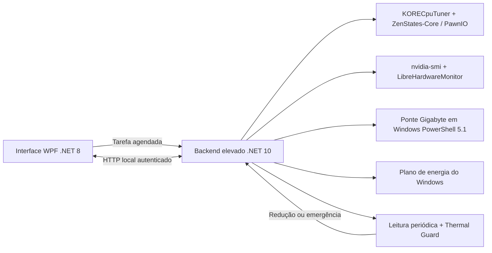

# KORE Overdrive

Controle experimental de perfis para **AMD Ryzen 7 5700X + NVIDIA GeForce RTX 3060** no Windows, com telemetria real, leitura após aplicação e proteção térmica.

O programa reúne ajustes da CPU, clock e limite de potência da GPU, plano de energia e ventoinhas em uma interface WPF. Ele mostra o que foi solicitado e o que o hardware realmente informou. Um clock alvo divergente, uma falha de sensor ou uma configuração mista aparecem como pendentes ou não confirmados.

**Estado do projeto:** versão experimental, feita e verificada em uma configuração específica. O perfil Desempenho Máximo ainda não tem estabilidade certificada. Esta versão não é um afinador universal para qualquer Ryzen, placa NVIDIA ou placa-mãe.

## Para que serve

- Alternar entre quatro perfis com um clique.
- Acompanhar uso total da CPU, temperaturas Tctl/Tdie e CCD, frequência, Vcore, RPM e Curve Optimizer dos oito núcleos.
- Ler clock, uso, potência, limite de potência, temperatura e ventoinha da GPU.
- Identificar limitação de potência ou temperatura na GPU.
- Restaurar os ajustes gerenciados pelo aplicativo com Stock ou Emergency Stock.
- Reduzir o perfil automaticamente quando os limites térmicos configurados forem atingidos.

## Perfis

| Perfil | CO em cada núcleo | Alvo do clock da GPU | Limite da GPU | Plano de energia | Ventoinhas |
| --- | ---: | ---: | ---: | --- | --- |
| Stock | 0 | Dinâmico, lock removido | 170 W | Equilibrado | Curva automática salva / controle padrão |
| Alto Desempenho | −5 | 1920 MHz | 187 W | Alto desempenho | 100% solicitado e relido |
| OC Médio | −10 | 1995 MHz | 187 W | Alto desempenho | 100% solicitado e relido |
| Desempenho Máximo | −15 | 2100 MHz | 187 W | Alto desempenho | 100% solicitado e relido |

Os valores de CO são passos do Curve Optimizer, não milivolts. O aplicativo **não escreve FMax**: ele exige e preserva o baseline de 4750 MHz desta configuração.

Stock restaura os ajustes que o aplicativo controla. Ele não redefine todas as opções da BIOS, PBO, tensões ou outras ferramentas. A política automática da ventoinha NVIDIA é solicitada ao driver; o aplicativo não tem uma leitura direta dessa política.

## Como funciona



### Telemetria e confirmação

A atualização ocorre aproximadamente a cada dois segundos, dependendo da resposta dos drivers. O uso da CPU vem dos tempos de execução e idle do Windows (`GetSystemTimes`). A temperatura principal é Tctl/Tdie lida diretamente pelo SMU/PawnIO; a leitura Gigabyte aparece para comparação, junto de frequência, Vcore e RPM.

A GPU é consultada pelo `nvidia-smi`. Nos perfis de desempenho, utilização abaixo de 20% mantém a validação do clock pendente. Com carga, são necessárias **três amostras consecutivas no clock alvo** para confirmar o clock. Um limitador de potência pode impedir atingir o alvo mesmo com todos os comandos aceitos.

Falhas de leitura não são convertidas em CO 0 nem em temperaturas inventadas. A interface sinaliza amostras desatualizadas e erros do backend. Essa confirmação de leitura não equivale a um teste prolongado de estabilidade.

### Thermal Guard

- CPU em **85 °C** ou GPU em **83 °C**: reduz um nível de perfil; reduções normais têm intervalo mínimo de 15 segundos.
- CPU ou GPU em **88 °C**: solicita Emergency Stock.
- Sensor principal indisponível durante um perfil de desempenho: solicita Stock.
- Depois de resfriar, não aumenta o perfil automaticamente.

Esses valores são regras do aplicativo para a configuração testada, não limites universais de segurança. O backend permanece em execução quando a janela fecha. Se o backend ou os drivers falharem, o aplicativo não consegue garantir essa proteção.

## Requisitos e compatibilidade

- Windows x64 e Windows PowerShell 5.1.
- Ryzen 7 5700X, oito núcleos e 16 threads; FMax baseline 4750 MHz e CO inicial 0 nos oito núcleos.
- NVIDIA GeForce RTX 3060 **desktop, sem Ti**, no índice 0 do `nvidia-smi`. O modelo verificado admite 170 W / 187 W; outras variantes podem rejeitar esses limites.
- Driver NVIDIA com `nvidia-smi` e suporte aos comandos utilizados.
- [PawnIO](https://pawnio.eu/) instalado para o acesso de baixo nível usado por ZenStates-Core.
- Gigabyte EasyTune Engine Service instalado, com as DLLs de monitoramento e controle de ventoinhas utilizadas pela ponte. A integração depende dessa API e não foi validada em todas as placas Gigabyte.
- [Fan Control](https://github.com/Rem0o/FanControl.Releases), disponibilizando `LibreHardwareMonitorLib.dll`. A compilação local foi verificada com a biblioteca 0.9.6.0 instalada por ele.
- .NET Desktop Runtime 8 e .NET Runtime 10 x64 para executar. Para compilar, SDK .NET 10 com suporte ao alvo .NET 8.

O instalador não baixa nem instala automaticamente os drivers e serviços acima. OCCT e FurMark 2 são opcionais; os botões atuais procuram as instalações feitas pelo WinGet. A interface exibe erro se elas não forem encontradas.

## Compilar

Clone ou baixe este repositório. A cópia fixada de ZenStates-Core já está incluída em `vendor/`, com sua licença e créditos.

```powershell
git clone https://github.com/nino204/KORE-Overdrive.git
cd KORE-Overdrive
.\scripts\Build.ps1
```

Se a biblioteca do Fan Control estiver em outro local:

```powershell
.\scripts\Build.ps1 -LibreHardwareMonitorPath 'D:\Apps\FanControl\LibreHardwareMonitorLib.dll'
```

A saída fica em `dist/`, sem tokens, logs nem baselines da máquina. O script compila os três componentes e executa as 12 verificações internas do backend. Essas verificações exercitam regras e não alteram o hardware.

## Instalar e abrir

Primeiro restaure os ajustes pretendidos como Stock e confirme CO 0 / FMax 4750 MHz. Feche outras ferramentas que escrevam os mesmos ajustes antes de operar os perfis.

Com os requisitos instalados, abra **PowerShell como administrador na mesma conta Windows que usará o aplicativo**:

```powershell
.\dist\Install.ps1
```

O instalador:

1. Copia o pacote para `%LOCALAPPDATA%\Programs\KORE Overdrive`.
2. Executa `capture-baseline`, que apenas lê a CPU e salva o arquivo local se CO 0 e FMax 4750 forem confirmados. Não altera CO, clock ou potência. Recusa sobrescrever um baseline existente.
3. Registra a tarefa `KOREOverdriveBackend` com privilégios elevados, sob a conta interativa atual, sem execução automática no logon.
4. Cria o atalho na Área de Trabalho.

Depois abra o atalho **KORE Overdrive** normalmente. A interface inicia a tarefa do backend e mostra os sensores. Abrir a interface não seleciona um perfil de desempenho; o Thermal Guard pode intervir em um perfil já ativo quando necessário.

O instalador recusa substituir uma tarefa ou instalação existente. Para migrar uma instalação anterior, preserve os baselines e ajuste os caminhos com revisão manual; não use o instalador para sobrescrever uma aplicação em execução.

Escolha um perfil e observe a confirmação. Para retornar, use **Stock**. **Emergency Stock** interrompe a aplicação de um perfil entre operações e tenta todas as etapas de restauração, registrando falhas individuais.

## Arquivos locais e comunicação

O backend usa `http://127.0.0.1:17863/`, com token aleatório no cabeçalho `X-Kore-Token`. O arquivo do token permite acesso à conta atual e SYSTEM; requisições com cabeçalho `Origin` são recusadas. Essa API é local, não um serviço para expor na rede.

| Arquivo | Finalidade |
| --- | --- |
| `%LOCALAPPDATA%\KOREOverdrive\api-token.txt` | Autenticação local, recriada a cada início do backend |
| `%LOCALAPPDATA%\KOREOverdrive\fan-baseline.json` | Curvas automáticas de ventoinhas capturadas localmente |
| `%LOCALAPPDATA%\KOREOverdrive\latest.json` | Último estado consultado |
| `%LOCALAPPDATA%\KOREOverdrive\hardware.log` | Leituras, aplicações e falhas |
| `%LOCALAPPDATA%\KOREOverdrive\ui-errors.log` | Erros da interface, quando houver |
| `Tools\CpuTuner\cpu-baseline.json` na instalação | Baseline local da CPU |

Nenhum desses arquivos da máquina usada no desenvolvimento foi publicado. Preserve os baselines da sua instalação; não copie baselines de outro computador.

## O que foi verificado

Na configuração de desenvolvimento, a interface renderizou, a leitura direta da CPU variou e o uso total foi acrescentado. O retorno a Stock confirmou CO 0 nos oito núcleos, FMax preservado, 170 W na GPU, plano Equilibrado e curvas automáticas da placa-mãe restauradas.

Sob FurMark, a GPU apresentou limitação de potência e não sustentou o alvo de 2100 MHz. O programa sinaliza esse resultado como não confirmado. **Desempenho Máximo não está certificado estável.**

Os scripts de distribuição têm compilação e sintaxe verificadas. Uma instalação limpa em outro computador e compatibilidade com outras variantes de hardware continuam pendentes. Veja [os detalhes de validação](docs/VALIDACAO.md).

## Estrutura e contribuições

```text
src/KOREOverdrive/           Interface WPF e modelos compartilhados
src/KOREOverdrive/Backend/   API local, hardware e proteção térmica
src/KORECpuTuner/            Helper de CPU e captura validada de baseline
vendor/ZenStates-Core/      Dependência fixada, com fonte e licença
scripts/                    Compilação e instalação
docs/                       Arquitetura e validação
```

Para relatar problemas, abra uma issue com modelo da CPU, GPU, placa-mãe, versões dos drivers e erro exibido. Remova tokens, dados pessoais e caminhos locais antes de anexar logs. Ao propor novos modelos ou perfis, inclua leituras reais após aplicação e comportamento de restauração.

## Licença e créditos

Distribuído sob **GPL-3.0**, conforme [LICENSE](LICENSE). A dependência [ZenStates-Core](https://github.com/irusanov/ZenStates-Core) é de irusanov e contribuidores, e seus créditos e arquivos originais foram preservados. Outras dependências e componentes externos mantêm suas respectivas licenças; consulte [THIRD_PARTY_NOTICES.md](THIRD_PARTY_NOTICES.md).

Alterar CO, clocks, limite de potência e ventoinhas pode causar instabilidade. Os valores deste projeto precisam ser avaliados no hardware utilizado; uma leitura confirmada não garante estabilidade.
